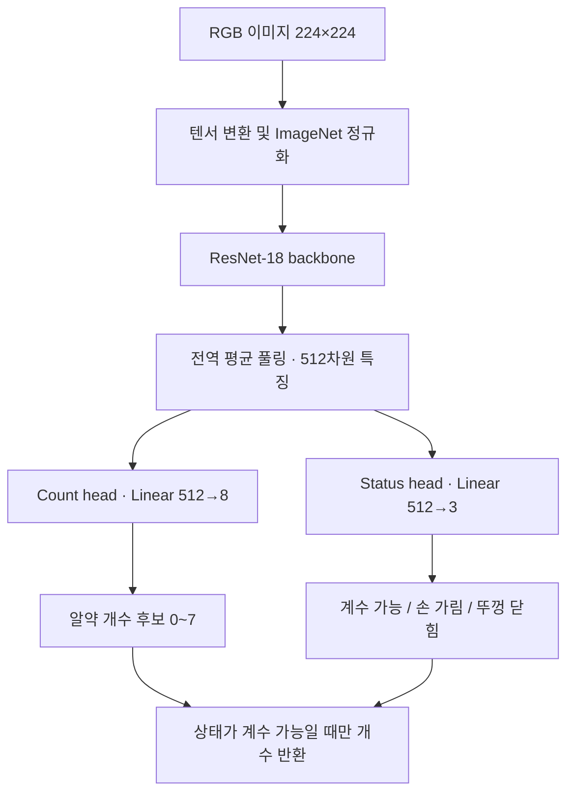

# CV-Medication-Detection

## 설명

스마트 알약통의 칸 이미지를 입력받아 **알약 개수와 계수 가능한 상태인지**를 판별하는 컴퓨터 비전 프로젝트다.

- **개수 분류:** `class0`~`class7`, 즉 알약 0 ~ 7개를 분류한다.
- **상태 분류:** `계수 가능`, `손 가림`, `뚜껑 닫힘`을 분류한다.
- **최종 판정:** 상태가 `계수 가능`일 때만 개수를 반환한다. 손에 가려졌거나 뚜껑이 닫힌 경우 개수는 `None`으로 처리한다.

Phase 1에서 개수 분류 모델을 학습하고, Phase 2에서 기존 개수 분류 기능을 유지하면서 상태 분류 head를 추가한다. 현재 저장된 Phase 1 및 Phase 2 학습은 모두 완료된 상태다.

## 워크스페이스 트리

```text
CV-Medication-Detection/
├── README.md
├── architecture/
│   └── model.py                         # ResNet-18 개수 모델 및 두 head를 가진 모델
├── detector/                            # RPi 배포 (아래 "배포" 참고)
│   ├── watcher.py                       # 뚜껑 열림/닫힘 판단 + 칸별 개수 확정
│   ├── interface.py, model.py           # 칸 크롭, ONNX 추론
│   ├── calibrate.py, bench.py           # ROI 보정, RPi 속도 측정
│   └── config.yaml                      # 모델 경로, ROI, 판정 기준
├── models/                              # 체크포인트, .onnx (git 제외)
├── tests/
└── training/
    ├── export_onnx.py                   # 체크포인트 → RPi용 ONNX
    ├── dataset_sampler.py               # 이미지 로딩, 정규화, 샘플 선택 및 중복 검사
    ├── train_phase1.py                  # 개수 분류 모델 학습
    ├── train_phase2.py                  # 상태 분류 head 학습
    ├── test_inference.py                # 체크포인트 평가 및 이미지별 예측 GUI
    ├── dataset/
    │   ├── train_n_val/
    │   │   ├── class0/ ~ class7/         # 개수별 합성 이미지
    │   │   ├── class_hand_occulusion/   # 손에 가려진 이미지
    │   │   └── class_lid_closed/        # 뚜껑이 닫힌 이미지
    │   └── test/
    │       ├── class0/ ~ class7/         # 개수별 실촬영 이미지; 현재 class7은 비어 있음
    │       ├── class_hand_occulusion/
    │       └── class_lid_closed/
    ├── dataset_synth_prep/              # 합성용 원본 배경·알약 자산 준비 위치
    ├── checkpoints/
    │   ├── phase1/
    │   └── phase2/
    ├── results/
    │   ├── phase1/
    │   └── phase2/
    └── utilities/
        ├── capture_rpi_image.py         # SSH를 통한 Raspberry Pi 카메라 촬영
        ├── resize_test.py               # ROI 선택 및 224×224 이미지 저장 GUI
        └── generate_synthetic_dataset.py # 알약 합성 데이터 생성 및 검증
```

위 트리의 데이터와 학습 산출물은 현재 로컬 워크스페이스 기준이다. 이미지, 체크포인트, 결과 파일은 Git에서 제외되므로 저장소를 clone한 뒤에는 별도로 준비하거나 생성해야 한다. `dataset_synth_prep/`에는 현재 원본 합성 자산이 포함되어 있지 않다.

## Model architecture

[architecture/model.py](architecture/model.py)에 ResNet-18 기반 모델을 정의한다.



| 구성 | Phase 1 | Phase 2 |
|---|---|---|
| 모델 | `build_model()` | `PillStateClassifier` |
| 초기 가중치 | ImageNet 사전 학습 ResNet-18 | Phase 1의 `best.pt` |
| Backbone | 전체 학습 | 가중치와 BatchNorm 통계 고정 |
| Count head | `Linear(512, 8)` 학습 | Phase 1 가중치 유지 및 고정 |
| Status head | 사용하지 않음 | `Linear(512, 3)`만 학습 |
| 출력 | 개수 logits `[B, 8]` | 개수 logits `[B, 8]`, 상태 logits `[B, 3]` |

두 head는 같은 512차원 특징을 공유한다. Phase 2에서 학습하는 파라미터는 상태 head의 **1,539개**다. Backbone이 고정되어 있으므로 이미지 특징을 한 번 추출해 캐시한 뒤 head를 학습한다.

모델은 softmax를 적용하지 않은 logits를 반환한다. 추론 코드에서 softmax와 `argmax`를 적용하며 상태 인덱스는 다음과 같다.

| 인덱스 | 상태 이름 | 의미 |
|---|---|---|
| 0 | `countable` | 계수 가능. 빈 통도 포함한다. |
| 1 | `hand_occlusion` | 손에 가려져 계수할 수 없음 |
| 2 | `lid_closed` | 뚜껑이 닫혀 계수할 수 없음 |

## 데이터셋 설명

### 이미지 규격 및 전처리

- 입력은 **224×224 PNG**이며 로딩 시 RGB로 변환한다.
- 텐서는 `[3, 224, 224]`, `float32`이고 픽셀값을 `255`로 나눈다.
- ImageNet 평균 `(0.485, 0.456, 0.406)`과 표준편차 `(0.229, 0.224, 0.225)`로 정규화한다.
- 학습·검증·추론 로더에서는 리사이즈, 크롭, 무작위 증강을 수행하지 않는다. 입력 이미지를 미리 규격에 맞춰 준비해야 한다.
- 합성 데이터 생성기는 별도로 알약 배치·회전, 장면 회전·반전, 밝기·대비·조명·그림자 변화를 적용한다.

### 현재 데이터 구성

`classN`은 알약 N개를 의미한다. 개수별 학습 이미지에는 알약 유형 A ~ D를 사용하며, class1 ~ 7은 각 유형당 500장씩 구성된다.

| 폴더 | 의미 | `train_n_val` | `test` |
|---|---|---:|---:|
| `class0` | 빈 통, 알약 0개 | 2,000 | 12 |
| `class1` | 알약 1개 | 2,000 | 12 |
| `class2` | 알약 2개 | 2,000 | 12 |
| `class3` | 알약 3개 | 2,000 | 12 |
| `class4` | 알약 4개 | 2,000 | 12 |
| `class5` | 알약 5개 | 2,000 | 12 |
| `class6` | 알약 6개 | 2,000 | 12 |
| `class7` | 알약 7개 | 2,000 | 0 |
| `class_hand_occulusion` | 손 가림 | 32 | 12 |
| `class_lid_closed` | 뚜껑 닫힘 | 32 | 12 |
| **합계** | | **16,064** | **108** |

손 가림 폴더의 `occulusion`은 현재 코드와 데이터에 사용 중인 철자다. 모델의 상태 이름은 `hand_occlusion`을 사용한다.

현재 학습 스크립트는 `train_n_val` 내부를 다시 분할하지 않는다. **`train_n_val`을 학습에, `test`를 학습 중 검증과 체크포인트 선택에 사용한다.**

Phase 1은 개수별 합성 이미지 16,000장으로 학습하고, class0~6의 실촬영 이미지 84장으로 검증한다. Phase 2는 아래 표본만 선택해 상태 레이블로 학습하며, 검증에는 현재 `test`의 108장을 모두 사용한다.

| Phase 2 상태 | 학습 표본 구성 | 학습 수 | 검증 수 |
|---|---|---:|---:|
| 계수 가능 | class0 256장 + class1~7 각각 4장 | 284 | 84 |
| 손 가림 | 해당 폴더 전체 | 32 | 12 |
| 뚜껑 닫힘 | 해당 폴더 전체 | 32 | 12 |
| **합계** | | **348** | **108** |

Phase 2 학습에는 상태별 표본 수의 역수를 가중치로 사용하는 `WeightedRandomSampler`를 적용한다. 한 epoch에 348번 복원 추출하며, 세 상태가 선택될 확률은 각각 1/3이다. 개별 epoch에서는 같은 이미지가 반복되거나 일부 이미지가 선택되지 않을 수 있다.

두 학습 스크립트는 선택한 학습·검증 이미지의 RGB 픽셀 해시를 비교해 완전히 동일한 이미지의 중복을 차단하고, 데이터 지문과 선택 내역을 체크포인트 폴더에 저장한다.

## Phase 1 / 2 학습

### 실행 환경과 공통 설정

프로젝트 루트에서 PyTorch, torchvision, NumPy, Pillow, tqdm, Matplotlib이 설치된 Python 환경으로 실행한다. 합성 데이터 생성에는 OpenCV가 추가로 필요하며, 이미지 GUI에는 Tk 8.6 이상과 Pillow의 ImageTk가 필요하다. 현재 저장된 Phase 1 실행 기록의 PyTorch 버전은 `2.7.0+cu128`이다.

학습 설정은 각 스크립트 상단의 전역 변수로 관리한다. 상대 경로는 프로젝트 루트 기준으로 해석하며, `DEVICE = "auto"`는 CUDA → MPS → CPU 순서로 장치를 선택한다. 학습 시드는 42이고, Phase 2의 표본 선택 시드도 42다.

| 설정 | Phase 1 | Phase 2 |
|---|---|---|
| 최대 epoch | 30 | 100 |
| 배치 크기 | 학습·검증 각각 64 | 16 |
| Optimizer | AdamW | AdamW |
| 초기 학습률 | `3e-4` | `1e-3` |
| Weight decay | `1e-4` | `1e-4` |
| 학습률 스케줄러 | CosineAnnealingLR, 최저 `1e-6` | 사용하지 않음 |
| 손실 함수 | CrossEntropyLoss | CrossEntropyLoss |
| 혼합 정밀도 | CUDA에서 AMP 사용 | FP32 |
| 조기 종료 기준 | 검증 정확도 7epoch 연속 미개선 | 검증 loss 20epoch 연속 미개선, 최소 개선량 `1e-4` |

### Phase 1: 개수 분류 학습

ImageNet 사전 학습 모델의 마지막 FC를 8개 클래스 출력으로 교체하고, backbone과 개수 head 전체를 학습한다.

```bash
python training/train_phase1.py
```

- 체크포인트: `training/checkpoints/phase1/`
- 학습 결과: `training/results/phase1/`
- `best.pt`: 검증 정확도가 가장 높은 모델의 state dict. 정확도가 같으면 기존 best를 유지한다.
- `last.pt`: 마지막 epoch의 모델·optimizer·scheduler 상태 등을 저장한다. 현재 스크립트에는 이 파일에서 자동으로 학습을 재개하는 CLI가 없다.
- `validation_split.json`: 사용한 데이터와 검증 이미지 목록, 전처리 및 데이터 지문을 저장한다.

출력 폴더에 기존 실행 파일이 있으면 실행을 중단한다. 재학습 시에는 스크립트의 `CHECKPOINT_DIR`와 `RESULTS_DIR`를 모두 새로운 경로로 설정한다.

### Phase 2: 상태 분류 head 학습

Phase 1의 `best.pt`를 불러와 backbone과 count head를 고정하고, 상태 head를 새로 초기화해 학습한다.

```bash
python training/train_phase2.py
```

- 체크포인트: `training/checkpoints/phase2/`
- 학습 결과: `training/results/phase2/`
- `best.pt`: 두 head를 포함한 모델 가중치, best epoch, 검증 지표, 학습 설정을 저장한다.
- `data_selection.json`: 선택한 학습·검증 이미지, 상태 매핑, 샘플링 설정, 데이터 지문을 저장한다.
- Best 선택 우선순위는 **높은 balanced accuracy → 적은 false accept → 낮은 validation loss**다.

기존 결과를 보존하며 다시 학습하려면 새로운 출력 경로를 지정한다.

```bash
python training/train_phase2.py \
  --checkpoint-dir training/checkpoints/phase2_run2 \
  --results-dir training/results/phase2_run2
```

다른 Phase 1 모델을 사용하려면 `--phase1-checkpoint <체크포인트 경로>`를 추가한다. 현재 Phase 2 스크립트는 기존 Phase 2 head를 이어서 학습하는 방식이 아니다.

### 학습 동작 확인

1epoch 동작 확인은 임시 출력 폴더를 사용한다. Phase 2 확인에는 실제 Phase 1 체크포인트가 필요하다.

```bash
python training/train_phase1.py --smoke-test
python training/train_phase2.py --smoke-test
```

학습된 체크포인트의 정확도와 이미지별 예측을 확인하려면 [test_inference.py 사용법](#test_inferencepy-사용법)을 참고한다.

## 학습 결과와 지표

**2026-11-22 현재 로컬에 저장된 실행 결과**다. 아래 값은 `training/results/phase1/evaluation_summary.json`과 `training/results/phase2/evaluation_summary.json`을 기준으로 작성했다. `before_phase12_split`의 과거 실험 결과는 포함하지 않는다.

### Phase 1: 개수 분류

| 지표 | 결과 |
|---|---:|
| 학습 이미지 | 16,000장 |
| 검증 이미지 | 84장, class0~6 |
| 실제 완료 epoch / 최대 epoch | 10 / 30 |
| Best epoch | 3 |
| 검증 정확도 | **95.24% (80/84)** |
| 검증 loss | 0.139010 |
| MAE | 0.047619개 |
| False empty rate | **0.00% (0/72)** |

MAE는 예측 개수와 실제 개수의 차이에 대한 절댓값의 평균이다. False empty rate는 알약이 있는 이미지 중 0개로 잘못 예측한 비율이다.

| 실제 개수 | 정답 / 검증 수 | 정확도 |
|---|---:|---:|
| 0개 | 12/12 | 100.00% |
| 1개 | 12/12 | 100.00% |
| 2개 | 12/12 | 100.00% |
| 3개 | 12/12 | 100.00% |
| 4개 | 12/12 | 100.00% |
| 5개 | 11/12 | 91.67% |
| 6개 | 9/12 | 75.00% |
| 7개 | 0/0 | 미평가 |

오류 4건은 모두 1개 적게 예측한 경우다. 실제 5개 이미지 1장을 4개로, 실제 6개 이미지 3장을 5개로 예측했다.

### Phase 2: 상태 분류

빈 통 표본을 256장으로 확대한 현재 설정의 학습 결과다.

| 지표 | 결과 |
|---|---:|
| 선택한 학습 이미지 | 348장 |
| 검증 이미지 | 108장 |
| 실제 완료 epoch / 최대 epoch | 100 / 100 |
| Best epoch | 100 |
| 검증 정확도 | **100.00% (108/108)** |
| Balanced accuracy | **100.00%** |
| 검증 loss | 0.008956 |
| False accept rate | **0.00% (0/24)** |
| False reject rate | **0.00% (0/84)** |

Balanced accuracy는 세 상태의 재현율을 평균한 값이다. False accept는 손 가림·뚜껑 닫힘을 계수 가능으로 잘못 허용한 경우이며, false reject는 계수 가능한 이미지를 손 가림·뚜껑 닫힘으로 잘못 거부한 경우다.

상태 혼동 행렬의 행은 실제 상태, 열은 예측 상태다.

| 실제 상태 ∖ 예측 상태 | 계수 가능 | 손 가림 | 뚜껑 닫힘 |
|---|---:|---:|---:|
| 계수 가능 | 84 | 0 | 0 |
| 손 가림 | 0 | 12 | 0 |
| 뚜껑 닫힘 | 0 | 0 | 12 |

### 두 head를 함께 사용한 최종 판정

현재 `phase2/best.pt`를 `test_inference.py`로 다시 평가한 결과, **상태와 개수를 함께 반영한 최종 정확도는 96.30% (104/108)**다. 상태 분류는 108장을 모두 맞혔으며, 개수 분류 오류 4건이 남아 있다. Phase 2의 상태 정확도 100%와 최종 개수 판정 정확도는 구분해서 해석해야 한다.

현재 `test` 폴더는 두 Phase의 체크포인트 선택에도 사용한다. 따라서 위 값은 독립 테스트 성능이 아닌 검증 성능이다. class7 실촬영 표본은 없으며, 실제 운영 성능을 확인하려면 학습·검증과 촬영 세션을 분리한 데이터를 추가로 평가해야 한다. 픽셀 해시 검사는 완전히 동일한 이미지의 중복을 검사하며, 같은 촬영의 유사 프레임까지 분리해 주지는 않는다.

## `test_inference.py` 사용법

### 실행과 입력 준비

PyTorch, torchvision, NumPy, Pillow가 설치된 Python 환경에서 프로젝트 루트로 이동해 실행한다.

```bash
python3 -m training.test_inference
```

기본 평가 폴더는 `training/dataset/test/`다. **224×224 PNG** 이미지를 실제 알약 개수에 해당하는 `class0/`~`class7/`에 넣는다. Phase 2 모델로 평가할 때는 손 가림 이미지를 `class_hand_occulusion/`에, 뚜껑 닫힘 이미지를 `class_lid_closed/`에 넣는다. 폴더명이 정답 레이블이 된다.

### 체크포인트와 실행 옵션

옵션은 [training/test_inference.py](training/test_inference.py) 상단에서 설정한다. `CHECKPOINT_DIR`과 `TEST_DIR`의 상대 경로는 프로젝트 루트 기준이며, `CHECKPOINT_NAME`의 상대 경로는 `CHECKPOINT_DIR` 기준이다.

| 설정 | 기본값 | 동작 |
|---|---|---|
| `CHECKPOINT_DIR` | `training/checkpoints/` | 체크포인트를 찾을 폴더 |
| `CHECKPOINT_NAME` | `None` | `phase2/best.pt` → `phase1/best.pt` → `261119_class07_best.pt` 순으로 탐색 |
| `TEST_DIR` | `training/dataset/test/` | 평가 이미지 폴더 |
| `BATCH_SIZE` | `32` | 한 번에 추론할 이미지 수 |
| `DEVICE` | `"auto"` | CUDA → MPS → CPU 순으로 선택. `"cuda"`, `"mps"`, `"cpu"`로 직접 지정 가능 |
| `SHOW_GUI` | `True` | 평가 후 이미지별 예측 창을 연다. 터미널에서만 확인하려면 `False`로 설정 |
| `GUI_PYTHON` | `None` | GUI가 실행될 별도 Python의 실행 파일 경로를 지정할 수 있음 |

예를 들어 `phase2_run2`의 모델을 별도 데이터로 평가하고 터미널에서 결과를 확인하려면 다음과 같이 설정한다.

```python
CHECKPOINT_NAME = "phase2_run2/best.pt"
TEST_DIR = "training/dataset/test_run2"
SHOW_GUI = False
```

### 결과 확인

- 터미널에는 클래스별 평가 수, 건너뛴 이미지 수, 정답·오답 수, 정확도와 전체 정확도가 출력된다. 열 수 없거나 입력 규격과 다른 이미지는 `[SKIP]` 사유와 함께 표시되며 정확도 집계에서 제외된다.
- Phase 1은 개수 정확도를 집계한다. Phase 2는 계수 가능 이미지에서 상태와 개수가 모두 맞을 때, 손 가림·뚜껑 닫힘 이미지에서는 해당 상태가 맞을 때 정답으로 집계한다. False accept와 false reject 건수도 함께 출력한다.
- GUI를 열려면 Tk 8.6 이상과 Pillow의 `ImageTk`를 사용할 수 있어야 한다. 창에서 `이전`·`다음` 버튼 또는 `←`·`→` 키로 이미지를 넘기며 실제 레이블, 예측, 정오답, softmax 점수를 확인한다. Phase 2에서 손 가림이나 뚜껑 닫힘으로 예측하면 `개수 예측 보류`가 표시된다.

## 배포 (RPi 추론)

스마트 알약통 CV 모듈. **통 전체 사진 + 연 칸 번호 → 그 칸의 알약 개수(0~7)**를 낸다.
학습 파트가 만든 ONNX 모델을 RPi 기기에서 실행한다. 복용 판정(전 − 후 비교)은 서버가 한다.

### 설치 / 실행

```bash
pip install -r requirements.txt
pytest
```

### 연동 (RPi SW)

뚜껑 센서가 없어서 CV가 사진으로 칸 열림/닫힘을 판단하고, **뚜껑이 닫힐 때 칸별 개수를 확정**한다.
RPi SW는 약 1초마다 통 전체를 찍어 `update`를 부르고, 나온 이벤트를 MQTT로 보내기만 한다.

```python
from dataclasses import asdict
from detector.watcher import PillboxWatcher

watcher = PillboxWatcher()   # 프로세스당 한 번 (모델도 한 번만 로드)
while True:
    for event in watcher.update(camera.capture(), datetime.now().astimezone()):
        mqtt.publish(topic, json.dumps(asdict(event), default=str))
    time.sleep(1)
# CountEvent(compartment_id=2, count=2, confidence=0.94, status="ok", captured_at=...)
```

- 칸마다 검은 바닥판이 보이면 열림, 흰 뚜껑이 보이면 닫힘. `switch_frames`장 연속이어야 상태를 바꾼다.
- 열려 있는 동안 매 장 개수를 세고, 닫히면 **같은 개수가 `stable_frames`장 연속 `min_confidence` 이상인 가장 최근 구간**을 결과로 낸다.
  손이 가린 사진이나 닫히는 중인 뚜껑은 이렇게 걸러진다.
- 그런 구간이 없으면 `status="uncertain"`, `count=None`. 서버는 판정에 쓰지 않는다.
- 서버는 칸별로 이번 `count`와 지난 `count`의 차이로 복용(줄어듦)/채움(늘어남)을 판정한다.
- 기준값은 `config.yaml`의 `watcher`에서 바꾼다.

한 칸만 바로 세고 싶으면 `count_pills(image, compartment_id) -> CountResult(compartment_id, count, confidence)`.

- image의 shape/dtype이 맞지 않거나, 칸 번호가 config에 없거나, ROI가 이미지 밖이면 `ValueError`
- `config.yaml`의 `model.path` 또는 해당 칸의 `rois`가 비어 있으면 `RuntimeError`
- 이미지는 디스크에 저장하지 않는다. image는 ROI를 잡은 사진과 같은 카메라 위치·해상도여야 한다.

### RPi 가상환경 설정

Raspberry Pi OS **64-bit** 기준 (32-bit에는 `onnxruntime`이 없음). 저장소 루트(`~/CV-Medication-Detection`)에서 한 번만 한다.

```bash
sudo apt install -y python3-picamera2            # 카메라 (apt로만 설치됨)
python3 -m venv --system-site-packages .venv     # apt로 깐 picamera2를 venv에서 쓰기 위해
. .venv/bin/activate
pip install onnxruntime Pillow PyYAML            # numpy는 설치하지 않는다 (아래 주의)
```

- 새 터미널을 열 때마다 `. .venv/bin/activate`로 가상환경을 켠다 (프롬프트 앞에 `(.venv)`가 붙음).
- **venv에 numpy를 따로 깔지 않는다.** picamera2는 시스템 numpy(apt)에 맞춰 빌드돼 있어 venv에 numpy 2.x가 들어가면 카메라가 깨질 수 있다.
  `pip install opencv-python`도 numpy 2.x를 같이 깔기 때문에 Pi에는 설치하지 않는다 (ROI 수동 보정은 PC에서).
  실수로 깔았다면 `pip uninstall -y opencv-python numpy`.
- 모델 파일은 git에 없다. PC의 `models/phase2_best.onnx`를 Pi의 `models/`에 복사한다 (`scp` 또는 MobaXterm Sftp).
- `.venv/`는 커밋하지 않는다 (`.gitignore`에 `.venv/` 추가). `git add .` 대신 파일 이름을 적어서 추가한다.

### RPi 실기기 테스트

가상환경을 켠 상태로 저장소 루트에서 실행한다. 둘 다 Ctrl+C로 끝낸다.

**1. 개수 세기** — `python test_count.py`

Enter를 누를 때마다 자동 초점 후 한 장 찍어 4칸의 개수와 처리 시간을 출력한다.

```text
1번 칸: 5개 (신뢰도 0.93)
2번 칸: 닫힘/가림 (신뢰도 1.00)
...
4칸 처리 1.2초
```

확인할 것:

- 칸마다 다른 개수(2~5개)를 넣었을 때 개수가 맞는지
- 약통을 1~2 cm 밀어도 결과가 같은지 (ROI 자동 보정)
- 닫은 칸이 `닫힘/가림`으로 나오는지
- 4칸 처리 시간이 5초 안인지

**2. 실제 동작 (watcher)** — `python test_watcher.py`

약 1초마다 찍어 `PillboxWatcher.update`를 부른다. 뚜껑을 열고 4초 이상 두었다가 닫으면 그 칸의 이벤트가 출력된다.

```text
CountEvent(compartment_id=2, count=4, confidence=0.96, status='ok', captured_at=...)
```

너무 짧게 열었거나 손이 계속 가리면 `status='uncertain'`, `count=None`이 정상이다.

틀린 결과가 나오면 `test_count.py`의 `img = cam.capture_array()` 다음 줄에
`from PIL import Image; Image.fromarray(img[..., ::-1]).save("fail.jpg")`를 넣어 사진을 남긴다.

> 스크립트는 `python - <<'EOF'`로 붙여 넣지 말고 파일로 실행한다. 표준 입력이 코드로 쓰여서 `input()`이 `EOFError`를 낸다.

### 속도 측정

모델이 아직 없으면 PC에서 랜덤 가중치 ONNX를 만들어 복사한다 (속도만 같고 개수는 의미 없음).

```bash
python -m training.export_onnx --random bench.onnx   # PC (torch 필요)
scp bench.onnx pi@<약통 Pi>:~/CV-Medication-Detection/
```

```bash
python -m detector.bench bench.onnx --camera     # RPi: 촬영 + 크롭 + 추론 시간, CPU 온도
```

`최악 1회(촬영 + 4칸 열림 update)`가 1000 ms 안이면 1초 간격 호출이 가능하다.
PC(데스크톱 CPU, 촬영 제외)에서는 약 210 ms였다.

### 칸 ROI 보정

**자동 보정 (매 사진)**: `count_pills`와 `PillboxWatcher.update`는 크롭 전에 항상 `align_rois`를 거친다.
`config.yaml`의 `rois` 주변(칸 크기의 ±20%)에서 검은 바닥판이 가장 꽉 차는 위치의 가운데로 박스를 옮긴다.
뚜껑이 닫힌 칸은 옮기지 않는다. 알약을 넣다가 통이 1~2 cm 밀리는 정도는 따로 할 일이 없다.

**수동 보정**: 카메라를 옮겼거나 통이 칸 크기의 20% 넘게 움직이면 뚜껑 4개를 모두 연 사진으로 ROI를 새로 잡는다.
창이 떠야 하므로 SSH만 쓸 때는 사진을 PC로 옮겨 PC에서 돌리고(`pip install opencv-python` 필요), 바뀐 `config.yaml`을 Pi로 복사한다.
기준: 칸마다 **검은 바닥판보다 조금 안쪽 박스** (흰 벽은 넣지 않음). 칸 번호는 사진 왼쪽부터 1~4.
박스를 그리기 전에 사진 창을 한 번 클릭해야 Enter/Esc가 먹는다.

```bash
python -m detector.calibrate 사진.jpg          # 칸 1→4 순서로 드래그 → Enter, 끝나면 Esc → config.yaml rois 저장
python -m detector.calibrate 사진.jpg --show   # 지금 rois를 사진에 그려 <사진>_rois.jpg로 확인만
```

### 모델 규격 (학습 → 배포)

RPi 기기 내 추론은 ONNX Runtime을 쓴다. RPi OS는 64-bit여야 한다 (PyPI에 32-bit ARM용 `onnxruntime` 없음).

- 모델: `architecture/model.py`의 `PillStateClassifier` (Phase 2, ResNet-18 + 개수 head 8 + 상태 head 3). Phase 1 `build_model`(개수만)도 된다.
- 변환: `python -m training.export_onnx models/phase2_best.pt` → 옆에 `.onnx` 생성. 그 경로를 `detector/config.yaml`의 `model.path`에 적는다.
  - 체크포인트와 `.onnx`는 git에 올리지 않는다 (`models/`). Pi에는 scp로 복사한다.
  - ImageNet mean/std 정규화는 모델 안에 들어간다.
- 전처리 (`detector/model.py`): `rois`의 `[x, y, w, h]`로 칸 크롭 → BGR→RGB → PIL LANCZOS로 224×224 → `/255` → `float32` `NCHW`
  - 학습 데이터(`resize_test.py`)와 같은 리사이즈를 쓴다. 비율이 바뀌어도 그대로 늘린다.
- 출력: `count_logits (1, 8)` (인덱스 = 개수), `status_logits (1, 3)` (`countable`, `hand_occlusion`, `lid_closed`)
  - 상태가 `countable`이면 `(개수, 개수 확률)`, 아니면 `(None, 상태 확률)`. watcher는 `None` 사진을 안정 구간에서 뺀다.

### 남은 일

- [x] 학습 파트에서 체크포인트 받기 → ONNX 변환 (Phase 2)
- [x] 칸별 ROI 좌표 재기 → `config.yaml`의 `rois` (2026-11-23 카메라 위치, 매 사진 자동 보정)
- [ ] 실제 RPi 사진으로 정확도 확인 (학습 검증은 합성 데이터만)
- [x] RPi에서 추론 시간 측정 (랜덤 가중치: 1칸 열림 약 0.3초, 4칸 0.9초)
